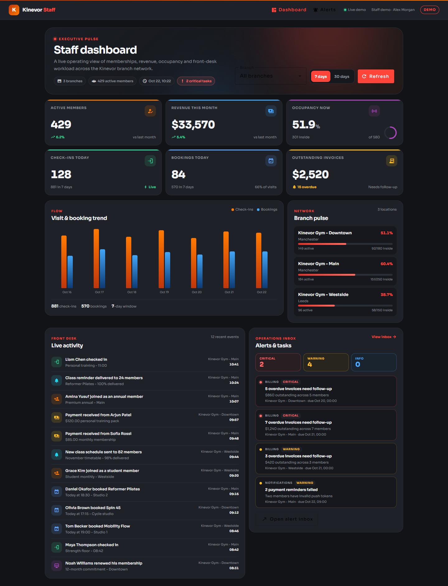
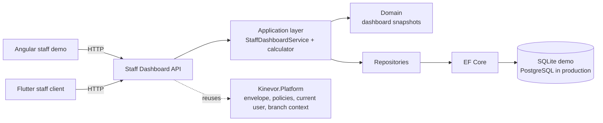
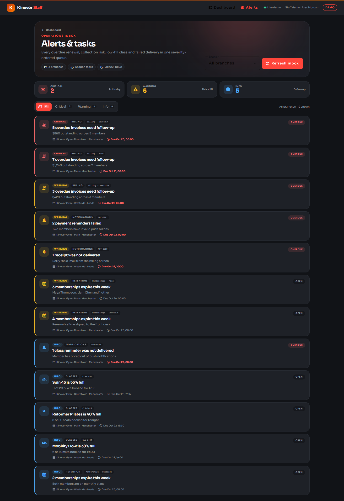
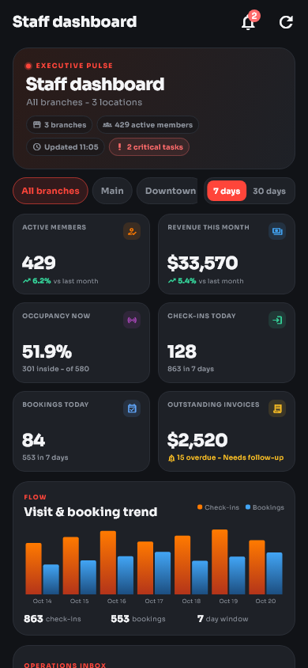
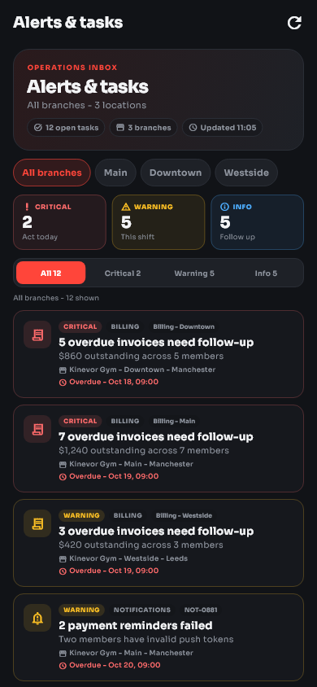
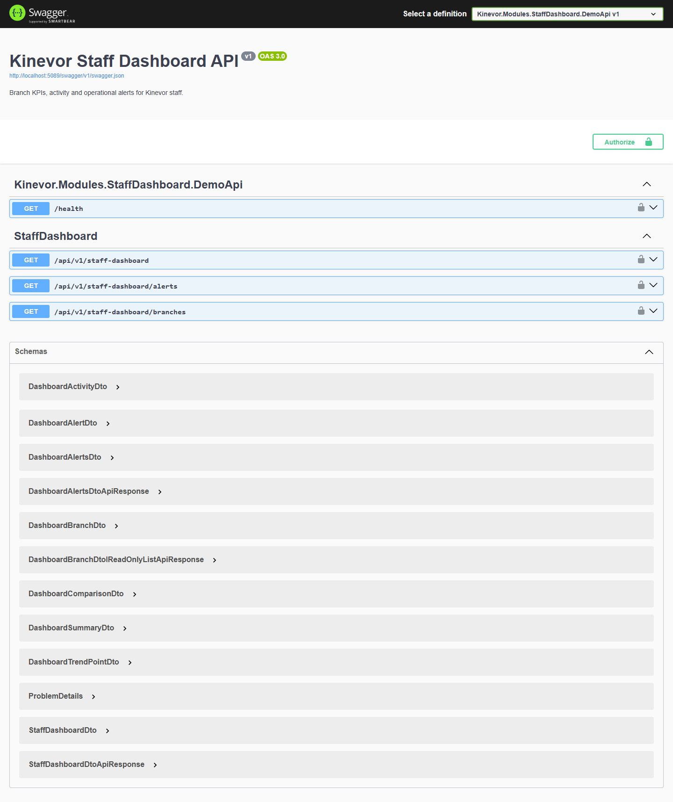

# Kinevor Staff Dashboard

Operating dashboard for the Kinevor gym platform: a .NET 9 API, a standalone
Angular library with a runnable web demo, and a Flutter package with a mobile
demo host. It gives front-desk and operations staff a branch-scoped view of
membership, revenue, occupancy, activity and alerts without the original Kinevor
monorepo.

[](https://github.com/SoftwareDeveloper98/kinevor-staff-dashboard/actions/workflows/ci.yml)
[](https://github.com/SoftwareDeveloper98/kinevor-staff-dashboard/pkgs/nuget/Kinevor.Modules.StaffDashboard)
[](https://github.com/SoftwareDeveloper98/kinevor-staff-dashboard/pkgs/npm/kinevor-staff-dashboard-web)
[](LICENSE)



## Why this module

The staff dashboard is the operating picture of a gym network. It answers the
questions a shift lead asks at the start of the day: who is in the building, how
are memberships and revenue moving, which branch is busiest, what happened at
the front desk and which tasks need attention now.

- Six headline KPIs for one branch or the whole network.
- 7- and 30-day visit and booking trend.
- Branch pulse with active members, occupancy and capacity.
- Recent check-in, booking, payment, membership and notification activity.
- Severity-ordered alert inbox for billing, retention, classes and delivery
  failures.
- Angular library with standalone components, typed gateway, facade, provider
  and routes.
- Flutter package with the staff dashboard, alert inbox, typed client and
  repository, plus a mobile demo host.
- SQLite demo with three seeded branches, trends, activity and alerts.

## Architecture



The backend reads one dashboard snapshot per branch and aggregates snapshots for
the all-branch view. The Angular library is a thin presentation layer over a
typed gateway and signal-based facade. The API contract is shared with the
Flutter client under `mobile/packages/kinevor_staff_dashboard`.

## Features

- Active members, monthly revenue, live occupancy, today's check-ins, today's
  bookings and outstanding invoices, each with comparison context.
- Occupancy ring, capacity footnotes and live branch selection.
- Seven or thirty days of check-in and booking trends with a readable bar chart.
- Branch pulse cards that switch the dashboard and alert inbox to one location.
- Twelve-event activity feed combining all branch snapshots.
- Complete alert inbox with critical, warning and info filters; the dashboard
  shows the six highest-priority alerts.
- Responsive Kinevor visual system with Sora typography and Material icons.
- Angular provider that works with an absolute API URL or a host-relative path.
- Demo role headers, CORS for the web demo and Swagger UI.
- Real web, mobile and Swagger screenshots checked into the repository.

## Endpoints

| Method | Route | Policy | Used by |
| --- | --- | --- | --- |
| `GET` | `/api/v1/staff-dashboard?branchId=&days=7` | `StaffOrAdmin` | Overview |
| `GET` | `/api/v1/staff-dashboard/alerts?branchId=` | `StaffOrAdmin` | Alert inbox |
| `GET` | `/api/v1/staff-dashboard/branches` | `StaffOrAdmin` | Branch selector |
| `GET` | `/health` | anonymous | Demo health check |
| `GET` | `/swagger` | development only | API explorer |

All responses use the platform `ApiResponse<T>` envelope. `days` accepts `7` or
`30`. A missing `branchId` returns the aggregate for every branch. The dashboard
endpoint returns the top six alerts; the alerts endpoint returns the complete
queue.

## Screenshots

### Web

| Dashboard | Alert inbox |
| --- | --- |
|  |  |

### Mobile

| Dashboard | Alert inbox |
| --- | --- |
|  |  |

### API



## Quick start

### Prerequisites

- .NET SDK 10 (the solution uses `.slnx`) and the ASP.NET Core 9 runtime.
- Node.js 22+ and npm 10+.
- Flutter 3.35+ only when working with the companion mobile package.

### 1. Build the platform packages

The backend restores `Kinevor.Platform.*` from the sibling platform repository's
package feed. Clone it next to this repository and pack it once:

```powershell
git clone https://github.com/SoftwareDeveloper98/kinevor-platform.git ..\kinevor-platform
dotnet pack ..\kinevor-platform\backend\Kinevor.Platform.slnx -c Release `
  -o ..\kinevor-platform\backend\artifacts\packages
```

If the platform packages are published to GitHub Packages, configure that source
instead and skip the local pack step.

### 2. Run the API

```powershell
dotnet restore backend\Kinevor.Modules.StaffDashboard.slnx
dotnet run --project backend\samples\Kinevor.Modules.StaffDashboard.DemoApi
```

The API listens on `http://localhost:5089`. Open
`http://localhost:5089/swagger` for the explorer. On first run the demo creates
a SQLite database and seeds three branches:

| Branch | City | Capacity | Active members |
| --- | --- | --- | --- |
| Kinevor Gym - Main | Manchester | 250 | 184 |
| Kinevor Gym - Downtown | Manchester | 180 | 149 |
| Kinevor Gym - Westside | Leeds | 150 | 96 |

The demo trusts development-only headers:

| Header | Purpose | Example |
| --- | --- | --- |
| `X-Demo-Role` | Selects the authenticated role | `Staff`, `Admin` |
| `X-Demo-Email` | Sets the current user e-mail | `staff.demo@kinevor.local` |
| `X-Demo-User` | Sets the current user subject | `staff-demo` |
| `X-Branch-Id` | Selects the branch context | branch GUID |
| `X-Demo-Branch` | Sets the home branch claim | branch GUID |

These headers are a demo adapter only. Never enable them in production.

### 3. Run the web demo

For local development, build the platform web package once:

```powershell
cd ..\kinevor-platform\web
npm install
npm run build
cd ..\..\kinevor-staff-dashboard\web
npm run install:local
npm start
```

`npm run install:local` temporarily points the workspace at the local platform
build, installs dependencies, restores `package.json`, and removes the generated
lockfile. When the platform package is available in GitHub Packages,
authenticate the scope in `.npmrc` and use the normal install path instead:

```powershell
cd web
npm install
npm start
```

The demo runs at `http://localhost:4207` with routes:

- `/dashboard` - KPIs, trend, branch pulse, activity and top alerts
- `/alerts` - complete alert inbox with severity filters

The demo interceptor sends the `Staff` role, e-mail and subject, and deliberately
does not send a branch header. The branch selector therefore starts on the
all-branch view; selecting a branch updates the query string used by the facade.

### 4. Flutter staff client

The companion Flutter package is scoped to
`mobile/packages/kinevor_staff_dashboard` and targets the same three dashboard
endpoints. It is released independently from the Angular demo.

```powershell
cd mobile\packages\kinevor_staff_dashboard
flutter pub get
flutter analyze
flutter test
cd example
flutter pub get
flutter run -d windows --dart-define=KINEVOR_API_BASE_URL=http://localhost:5089/api/v1
```

The demo sends the development-only `Staff` role, e-mail and subject headers.
Use `flutter run -d chrome` for the web build or
`http://10.0.2.2:5089/api/v1` on an Android emulator. The 7/30-day range and the
branch selector update the same query parameters as the Angular facade.

### 5. Refresh screenshots

With both servers running, refresh the web and Swagger screenshots:

```powershell
cd web
npm run capture:screenshots
```

The Playwright script opens Chrome at `1440x1040`, waits for each screen to
render and writes `web-dashboard.png`, `web-alerts.png` and `api-swagger.png` to
`docs/screenshots`.

Mobile screenshots come from the committed Flutter goldens:

```powershell
cd mobile\packages\kinevor_staff_dashboard
flutter test --update-goldens test\staff_dashboard_golden_test.dart
Copy-Item test\goldens\staff_dashboard.png ..\..\..\docs\screenshots\mobile-dashboard.png
Copy-Item test\goldens\staff_alerts.png ..\..\..\docs\screenshots\mobile-alerts.png
```

## Testing

| Area | Command |
| --- | --- |
| Backend | `dotnet test backend\Kinevor.Modules.StaffDashboard.slnx -c Release` |
| Web unit tests | `cd web; npm test` |
| Web builds | `cd web; npm run build:all` |
| Web install from local platform | `cd web; npm run install:local` |
| Flutter package | `cd mobile\packages\kinevor_staff_dashboard; flutter analyze; flutter test` |
| Flutter example | `cd mobile\packages\kinevor_staff_dashboard\example; flutter analyze; flutter build web` |

The backend suite covers dashboard calculations, domain rules and the authorized
API against the demo host. The web suite covers the HTTP gateway and facade with
Vitest. The Flutter suite covers the client, parsing, dashboard states, branch
and range controls, alerts filters and 390x844 goldens.

## Packages

| Ecosystem | Package | Contents |
| --- | --- | --- |
| NuGet | `Kinevor.Modules.StaffDashboard` | Domain, application, API controller and module registration |
| NuGet | `Kinevor.Modules.StaffDashboard.EntityFrameworkCore` | `DashboardDbContext`, mapping and repositories |
| npm | `@softwaredeveloper98/kinevor-staff-dashboard-web` | Angular components, gateway, facade, provider and routes |
| Flutter | `kinevor_staff_dashboard` | Dashboard, alert inbox, typed client and repository |

Install the Angular library after authenticating to GitHub Packages:

```powershell
npm install @softwaredeveloper98/kinevor-staff-dashboard-web
```

The Angular package expects `@softwaredeveloper98/kinevor-platform-web` as a peer
dependency.

CI restores the platform NuGet and npm packages from GitHub Packages. Publish
`kinevor-platform` `0.1.0` first, or the backend and web jobs will fail at
restore/install. The Flutter job runs on Windows, formats, analyzes, tests and
builds the example without external package dependencies.

## Design decisions

- **Read model first.** The module serves snapshots rather than rebuilding every
  KPI from source modules on each request. The API owns aggregation and
  presentation-ready projections.
- **One contract, three clients.** The overview and alerts endpoints reuse the
  same branch and alert DTOs, so the Angular and Flutter clients stay aligned.
- **Branch scope is explicit.** A query branch wins over the host branch context;
  omitting it aggregates every branch. The web demo leaves the header unset so
  the all-branch view loads by default.
- **Thin clients.** The HTTP gateway is swappable and the Angular facade owns
  loading state, branch selection and range changes. The demo is only a shell.
- **Severity is part of the ordering.** Alerts are ordered critical first, then
  by due date. The overview always shows the highest-priority six.
- **Demo auth is isolated.** Trust headers exist only in the Development demo
  host; production hosts must supply the platform authentication and
  authorization stack.
- **Visual contract in tests.** Playwright screenshots make layout, typography
  and density regressions visible between releases.

## Repository layout

```text
kinevor-staff-dashboard/
  backend/
    src/Kinevor.Modules.StaffDashboard/                domain, application, API
    src/Kinevor.Modules.StaffDashboard.EntityFrameworkCore/
    samples/Kinevor.Modules.StaffDashboard.DemoApi/
    tests/Kinevor.Modules.StaffDashboard.Tests/
  web/
    projects/kinevor-staff-dashboard/                  Angular library
    projects/demo/                                     demo host
    scripts/                                           local install + screenshots
  mobile/
    packages/kinevor_staff_dashboard/                  Flutter package + demo
  docs/
    screenshots/
  .github/workflows/
```

## Related modules

- [Kinevor Platform](https://github.com/SoftwareDeveloper98/kinevor-platform) -
  shared API, auth, i18n, notices and Angular primitives.
- [Kinevor Identity & Access](https://github.com/SoftwareDeveloper98/kinevor-identity-access)
- [Kinevor Trainers](https://github.com/SoftwareDeveloper98/kinevor-trainers)
- [Kinevor Members](https://github.com/SoftwareDeveloper98/kinevor-members)
- [Kinevor Memberships](https://github.com/SoftwareDeveloper98/kinevor-memberships)
- [Kinevor Classes & Bookings](https://github.com/SoftwareDeveloper98/kinevor-classes-bookings)
- [Kinevor Check-ins & Access](https://github.com/SoftwareDeveloper98/kinevor-checkins-access)
- [Kinevor Payments & Billing](https://github.com/SoftwareDeveloper98/kinevor-payments-billing)
- [Kinevor Notifications](https://github.com/SoftwareDeveloper98/kinevor-notifications)
- [Kinevor Public Site](https://github.com/SoftwareDeveloper98/kinevor-public-site)

## Release Checklist

- Confirm `kinevor-platform` `v0.1.0` is published.
- Add the `KINEVOR_PACKAGES_TOKEN` repository secret.
- Push tag `v0.1.0` after CI is green.

See [PUBLISHING.md](PUBLISHING.md) for the complete release and consumer setup.

## Security

The demo role headers are intentionally insecure and exist only for local
screenshots and tests. Production hosts must use the platform authentication
stack, enforce the published policies, and keep the demo adapter disabled. Do not
commit connection strings, PATs or `.env` files. The demo database contains
illustrative member and revenue data only.

## License

MIT. See [LICENSE](LICENSE).
